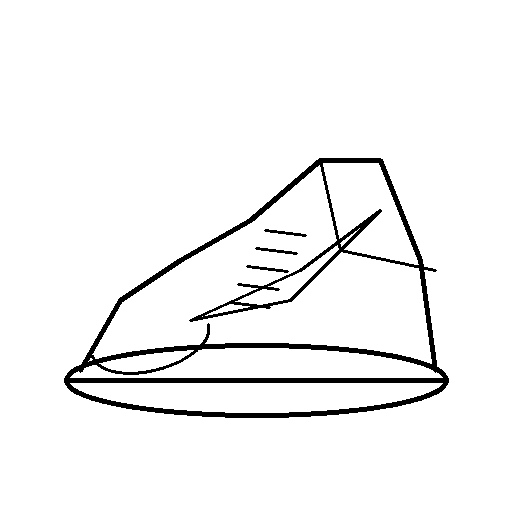
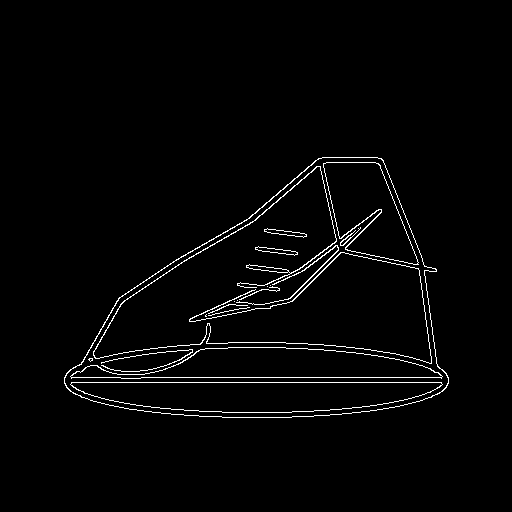
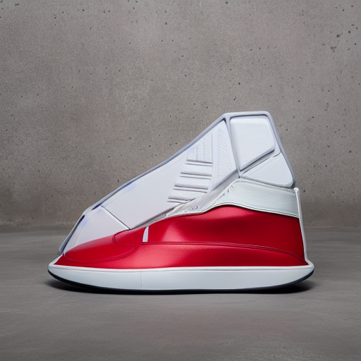

# 🎨 ForgeDiT Studio

### Sketch → Photorealistic Product Render Pipeline

*ControlNet-conditioned latent diffusion with an interactive Gradio studio*

[](https://www.python.org/)
[](https://pytorch.org/)
[](https://huggingface.co/docs/diffusers)
[](LICENSE)

> A designer draws a rough sketch → ForgeDiT extracts its structure → a diffusion model renders a studio-style product image that follows the original shape.

---

## 📸 Results

<!-- Replace with real outputs. One row per example: sketch | structural mask | render. -->

| Input sketch | Structural mask | Render |
| :---: | :---: | :---: |
|  |  |  |

*Prompt, seed, preprocessor, and ControlNet scale for each example are listed in [`outputs/README.md`](outputs/) (TODO).*

---

## 🧠 What it does

ForgeDiT Studio turns a 2D line sketch into a product render by combining three stages:

1. **Structural preprocessing** — converts the sketch into a conditioning map (Canny, HED, or depth).
2. **ControlNet conditioning** — feeds that map to a ControlNet attached to Stable Diffusion v1.5, so the output follows the sketch geometry.
3. **Text-guided rendering** — a prompt built from product, material, finish, and lighting presets controls appearance.

> **A note on the name:** the current backbone is Stable Diffusion v1.5 (a UNet), not a Diffusion Transformer. "DiT" is the long-term direction (see the [Roadmap](#️-roadmap)), not the current architecture.

---

## 🏗️ Architecture

```
[Sketch] ──► [Preprocessor: Canny | HED | Depth] ──► [ControlNet (matching mode)]
                                                            │
[Prompt builder: product + material + finish + lighting] ──►[SD v1.5 + UniPC/LCM]──► [Render(s)]
```

| Component | Model | Purpose |
| --- | --- | --- |
| Base model | `runwayml/stable-diffusion-v1-5` | Latent diffusion backbone |
| ControlNet (Canny) | `lllyasviel/sd-controlnet-canny` | Hard-edge geometry conditioning |
| ControlNet (HED) | `lllyasviel/sd-controlnet-hed` | Soft-contour conditioning |
| ControlNet (Depth) | `lllyasviel/sd-controlnet-depth` | Depth conditioning |
| Standard sampler | `UniPCMultistepScheduler` | 20-step default |
| Turbo sampler | `latent-consistency/lcm-lora-sdv1-5` + `LCMScheduler` | 4-step fast mode (CFG fixed at 1.0) |

ControlNet adapters are loaded lazily, cached, and hot-swapped on the pipeline when the preprocessor mode changes. The LCM LoRA is fused and unfused when switching between Standard and Turbo.

---

## ✨ Features

- **Three preprocessor modes:** Canny, HED soft contours, and MiDaS depth, each paired with its matching ControlNet
- **Two inference modes:** Standard (20 steps) and Turbo (4-step LCM)
- **Batch variants:** single render or a 2×2 contact sheet with per-variant seeds
- **Prompt builder:** product category, material, finish, and lighting dropdowns plus free-text accents
- **Tunable generation:** ControlNet strength, CFG scale, steps, seed, Canny thresholds, negative prompt
- **Inspectable pipeline:** view the structural mask and the final prompt for every render
- **Reproducible:** fixed seeds, with seed + index per variant

---

## 📁 Project structure

```
ForgeDiT/
├── src/
│   ├── sketch_generator.py   # Programmatic sample sneaker sketch (OpenCV)
│   ├── preprocessor.py       # Canny / HED / depth structural mask extraction
│   ├── pipeline.py           # ProductDesignPipeline: ControlNet swap, Turbo/LCM, batching
│   └── grid_utils.py         # 2×2 contact-sheet composition
├── outputs/                  # Example and generated artifacts
├── app.py                    # Gradio web studio
├── run_phase1.py             # CLI runner: sketch → mask → render
├── requirements.txt
├── LICENSE
└── README.md
```

---

## 🚀 Quick start

```bash
git clone https://github.com/shanujya/ForgeDiT.git
cd ForgeDiT

python3 -m venv venv
source venv/bin/activate        # Windows: venv\Scripts\activate

pip install -r requirements.txt
```

**Launch the studio**

```bash
python3 app.py
```

Open `http://localhost:7860`. Upload or paste a sketch (or click *Load Sample Sketch*), choose a preprocessor and presets, and render.

**Run the CLI pipeline**

```bash
python3 run_phase1.py
```

This generates the sample sketch, extracts the edge map, and writes a render to `outputs/`.

> ⚠️ **First run** downloads several GB of weights (base model, ControlNets, and, on first use, HED/MiDaS annotators and the LCM LoRA). A CUDA GPU is strongly recommended; CPU inference works but takes minutes per image.

---

## ⚙️ Configuration

| Parameter | Default | Description |
| --- | --- | --- |
| `controlnet_conditioning_scale` | `0.8` | How strongly the output follows the conditioning map (0.0–1.0) |
| `guidance_scale` | `7.5` | CFG scale: prompt influence (forced to `1.0` in Turbo mode) |
| `num_inference_steps` | `20` | Denoising steps (forced to `4` in Turbo mode) |
| `seed` | `42` (CLI) / `-1` random (UI) | Random seed |
| Canny thresholds | `100` / `200` | Low/high hysteresis thresholds (Canny mode only) |

---

## 📦 Dependencies

```
torch
torchvision
diffusers >= 0.25.0
transformers >= 4.36
accelerate >= 0.25.0
peft                  # required by diffusers for LCM LoRA loading
controlnet_aux        # HED and MiDaS annotators
gradio
opencv-python
pillow
numpy
```

---

## 🖥️ Hardware

| Setup | VRAM | Notes |
| --- | --- | --- |
| NVIDIA GPU | 8 GB+ | Recommended: FP16, fast inference |
| NVIDIA GPU | 4–8 GB | Works with attention slicing |
| CPU only | n/a | Functional but slow (FP32) |

---

## ⚠️ Known limitations

These are open issues, not planned features.

- **Sketch input quality.** The ControlNet checkpoints used here were trained on edge/depth maps derived from photographs, not hand-drawn sketches. Canny on a drawn line produces doubled outlines. The sketch-specific ControlNets (lineart, scribble) are not yet integrated.
- **Depth mode.** MiDaS is trained on photographs and is not expected to produce meaningful depth from thin line art. Treat it as experimental for sketch input.
- **Preprocessor fallbacks.** If HED or MiDaS fail to load, a crude OpenCV fallback is used silently. The UI status line does not yet report this.
- **Input resizing.** Non-square sketches are resized to 512×512 without preserving aspect ratio, which distorts geometry.
- **Multi-product support is prompt-level only.** The product dropdown changes the text prompt. There are no product-specific sketches, tests, or tuned settings yet.
- **No quantitative evaluation yet.** Output quality is judged by eye. See the roadmap.
- **Model hosting.** If `runwayml/stable-diffusion-v1-5` fails to download, the weights are mirrored under `stable-diffusion-v1-5/stable-diffusion-v1-5`; update `BASE_MODEL_ID` in `src/pipeline.py`.

---

## 🗺️ Roadmap

**Phase 1: Core pipeline** ✅
Sketch → Canny → ControlNet → render (CLI)

**Phase 2: Interactive studio** ✅
Gradio UI, prompt builder, multi-preprocessor, Turbo mode, batch variants

**Phase 3: Stabilize and evaluate** 🚧 *(current focus)*
- [ ] Verify ControlNet hot-swapping on CUDA (move cached adapters to device)
- [ ] Surface preprocessor fallbacks in the UI instead of failing silently
- [ ] Aspect-preserving letterbox resize
- [ ] Add lineart and scribble ControlNets and compare against Canny/HED
- [ ] Evaluation harness: geometry fidelity (edges re-extracted from the render vs. the input mask), CLIP prompt adherence, sweeps over ControlNet scale / steps / Turbo
- [ ] Test on real hand-drawn sketches (e.g. the QMUL ShoeV2 sketch–photo dataset)

**Phase 4: Training** 📋
- [ ] Fine-tune a ControlNet/adapter on real sketch–photo pairs and compare against the off-the-shelf baselines from Phase 3
- [ ] Product-photography style LoRA

**Phase 5: Backbone upgrade** 🔭
- [ ] Port the pipeline to a DiT-based backbone with ControlNet support
- [ ] Inpainting for local edits (change one material or component)

---

## 👤 Author

**Shanujya Mishra** — © 2026

## 📄 License

MIT. See [LICENSE](LICENSE).